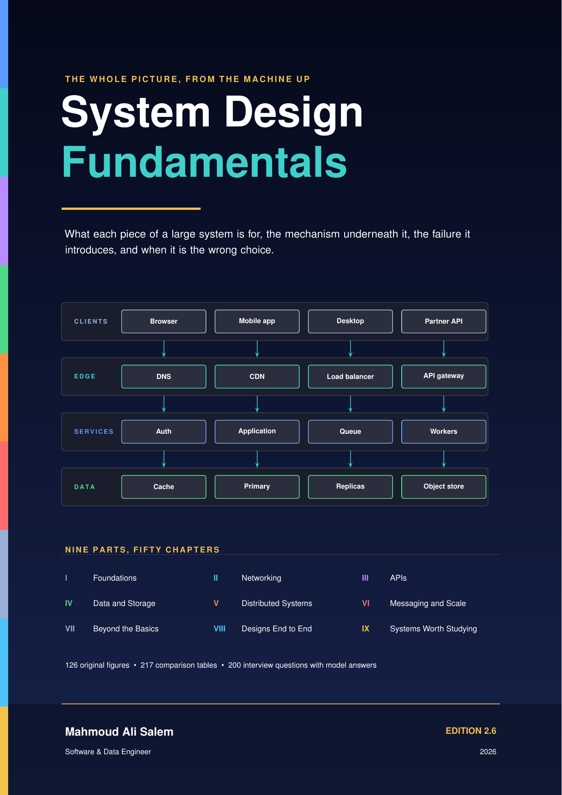
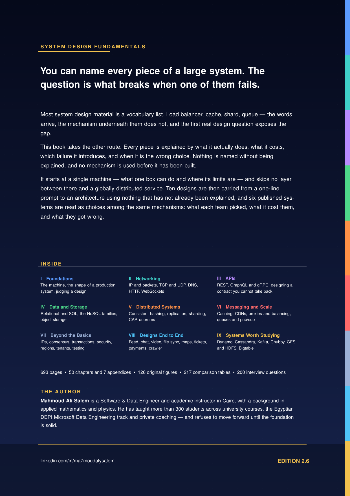

&nbsp;&nbsp;

# System Design Fundamentals

### *The whole picture, from the machine up.*

---

## Why This Book Exists

Ask most developers what a load balancer is and you get a definition. Ask what happens when it dies, and the room goes quiet.

That gap is the whole problem with how system design is usually taught. The vocabulary arrives first — cache, shard, queue, replica, CDN — and the mechanism underneath it never does. You can recite the pieces and still have no idea which one to reach for, what it costs you, or what it breaks when it fails. Then the first real design question exposes all of it at once.

**This book is written for that developer.**

It starts at a single machine — what one box can actually do and where its limits are — and does not skip a layer between there and a globally distributed service. Every piece is explained by what it does, the mechanism that makes it work, the failure it introduces, and when it is the wrong choice.

By the time you reach the case studies, you are not reading about Dynamo and Kafka as famous systems. You are reading them as choices among mechanisms you already understand.

---

## How This Book Teaches

This is not a reference you skim before an interview. It is a **step-by-step build** on three principles:

**1. Nothing is named without being explained.**
No chapter uses a term the book has not already built. You learn what a quorum physically is before you meet leaderless replication. You understand what a hash ring does to key movement before anyone says "resharding".

**2. Every mechanism is explained with its failure.**
Most material tells you what a component is for. This book tells you what it does under the hood, what it costs, which new failure mode it introduces, and the specific situation in which reaching for it is a mistake. A section titled *when this is the wrong choice* closes almost every mechanism in the book.

**3. Numbers, not adjectives.**
"Fast" and "scalable" are not answers. Every chapter works one numeric example through to a conclusion — how many requests that machine really serves, what the transatlantic round trip actually costs you, how much the cache has to hold before it earns its place.

---

## Who Is This For?

| You are... | This book gives you... |
|---|---|
| A developer who has only built single-server apps | A patient start from one machine, with no assumed distributed-systems background |
| Someone preparing for system design interviews | 200 interview questions with model answers, ten designs carried end to end, and twenty-seven more to attempt yourself |
| A backend engineer who knows the words | The mechanisms underneath them, and the failure each one introduces |
| A team lead choosing an architecture | The trade-off framing — CAP and PACELC, consistency models, and when each mechanism is wrong |
| A data or platform engineer | Replication, sharding, queues, stream processing, and the papers that defined them |

**Prerequisites:** You can write and deploy a program that talks to a database. That is genuinely all you need.

---

## 📬 Get the Book

A professional 693-page PDF: 126 original diagrams, 217 comparison tables, annotated code and configuration, a full glossary, a subject index, and an index of every interview question with the page that answers it.

> Reach out on LinkedIn with "System Design Book" in the message — I respond to every request.

---

## What's Inside — 50 Chapters

<strong>Part I — Foundations</strong>

> Three chapters that fix the vocabulary. What one machine can do and what it costs, what a production system is actually made of, and how to judge a design once you have one.

| Chapter | What You'll Learn |
|---|---|
| 1. Computer Architecture | CPU, memory, disk and network as a latency hierarchy; what one machine really serves |
| 2. Application Architecture | The shape of a production system: tiers, statelessness, and where the state actually lives |
| 3. Design Requirements | Availability, latency, throughput, durability — and the arithmetic behind each number |

<strong>Part II — Networking</strong>

> How bytes get from one machine to another, built one layer at a time.

| Chapter | What You'll Learn |
|---|---|
| 4. Networking Basics | Addresses, packets, routing, and why the network is not a wire |
| 5. TCP and UDP | What each protocol guarantees, what it gives up, and how to choose |
| 6. DNS | Resolution, records, TTLs, and DNS as a load-balancing tool in its own right |
| 7. HTTP | Methods, status codes, headers, keep-alive, HTTP/2 and HTTP/3 |
| 8. WebSockets and Real-Time Communication | Long polling, SSE, WebSockets — and what to do when request/response is the wrong shape |

<strong>Part III — APIs</strong>

> The contract between two services, and the discipline of designing one you cannot take back.

| Chapter | What You'll Learn |
|---|---|
| 9. API Paradigms | REST, GraphQL and gRPC — the forces that actually separate them |
| 10. API Design | Resources, versioning, pagination, idempotency, errors that a client can act on |

<strong>Part IV — Data & Storage</strong>

> Where the data lives, and what each store is genuinely good at.

| Chapter | What You'll Learn |
|---|---|
| 11. Relational Databases and SQL | Indexes, transactions, isolation levels, and what a query planner is doing |
| 12. NoSQL and Non-Relational Stores | Key-value, document, wide-column, graph — one family per access pattern |
| 13. Object Storage | Blobs, presigned URLs, storage classes, and why it is not a filesystem |

<strong>Part V — Distributed Systems</strong>

> The point where one machine stops being enough, and everything gets harder.

| Chapter | What You'll Learn |
|---|---|
| 14. Consistent Hashing | The ring, virtual nodes, and how much data moves when a node joins or dies |
| 15. Replication and Sharding | Leader-follower, multi-leader, replication lag, shard keys and hot shards |
| 16. CAP, PACELC and Consistency Models | What the theorem actually says, and the models between strong and eventual |
| 17. Leaderless Replication and Anti-Entropy | Quorums, read repair, Merkle trees, vector clocks and conflict resolution |

<strong>Part VI — Messaging & Scale</strong>

> Making it bigger without making it fragile.

| Chapter | What You'll Learn |
|---|---|
| 18. Caching | Where to put it, eviction policies, invalidation, stampedes and the thundering herd |
| 19. Content Delivery Networks | How a request finds the nearest edge, and why a CDN speeds up what it cannot cache |
| 20. Proxies and Load Balancing | Forward and reverse proxies, L4 vs L7, algorithms, health checks, the balancer's own failure |
| 21. Message Queues and Pub/Sub | Delivery semantics, ordering, backpressure, dead-letter queues, consumer groups |

<strong>Part VII — Beyond the Basics</strong>

> The pieces an introduction never reaches and a complete reference cannot leave out.

| Chapter | What You'll Learn |
|---|---|
| 22. Rate Limiting and Throttling | Token bucket, leaky bucket, sliding window — and limiting across many machines |
| 23. Unique IDs at Scale | UUIDs, Snowflake, ULIDs, clock skew, and why auto-increment stops working |
| 24. Consensus and Coordination | Raft in full, leader election, distributed locks and what a lease really guarantees |
| 25. Distributed Transactions | Two-phase commit, sagas, the outbox pattern, exactly-once as a claim |
| 26. Observability | Metrics, logs, distributed tracing, SLIs and SLOs, and alerting that does not cry wolf |
| 27. Security and Authentication | TLS, OAuth 2.0 and OIDC, JWTs and their sharp edges, secrets, common attack surfaces |
| 28. Search and Inverted Indexes | Tokenisation, the inverted index, relevance scoring, distributed search |
| 29. Batch and Stream Processing | MapReduce to modern engines, windows, watermarks, event time vs processing time |
| 30. Service Architecture | Service discovery, the API gateway, call chains, CQRS and event sourcing |
| 31. Analytical Storage | OLTP vs OLAP, column-oriented storage, compression, warehouses and lakes |
| 32. Multi-Region and Disaster Recovery | RTO and RPO, failure domains, the four postures, failover step by step |
| 33. Multi-Tenancy and Isolation | Silo, bridge and pool; noisy neighbours; sharding by tenant |
| 34. Testing Distributed Systems | Fault injection, history checking, chaos experiments, load tests that mean something |

<strong>Part VIII — Designs End to End</strong>

> Ten designs carried from a one-line prompt to a full architecture, using nothing that has not already been explained.

| Chapter | What You'll Design |
|---|---|
| 35. URL Shortener | Key generation, redirect path, analytics, and the read-heavy shape |
| 36. News Feed | Fan-out on write vs read, the celebrity problem, ranking and pagination |
| 37. Group Chat System | Connection state, delivery and read receipts, presence, message history |
| 38. Video Platform | Upload and transcoding pipelines, adaptive bitrate streaming, CDN strategy |
| 39. File Sync and Storage | Chunking, deduplication, delta sync, conflict resolution across devices |
| 40. Maps and Proximity Search | Geohashing and quadtrees, nearest-neighbour queries, routing at scale |
| 41. Ticket Sale | Contention on a fixed supply: an admission gate, seat holds, and paying exactly once |
| 42. Payment System | A payment as a state machine, two idempotency keys, a double-entry ledger, reconciliation |
| 43. Notification System | Push, email and SMS through providers that rate-limit; priority lanes; duplicates vs loss |
| 44. Web Crawler | The frontier, politeness, a Bloom filter for seen URLs, freshness against coverage |

<strong>Part IX — Systems Worth Studying</strong>

> Six published systems read as choices among the same mechanisms: what each team picked, what it cost them, and what they got wrong.

| Chapter | What You'll Learn |
|---|---|
| 45. Dynamo | Consistent hashing and quorums in production, and the price of always-writable |
| 46. Cassandra | What it kept from Dynamo, what it took from Bigtable, and the LSM tree underneath |
| 47. Kafka | The log as a primitive: partitions, offsets, replication, exactly-once semantics |
| 48. Chubby | A lock service as the coordination backbone, and the lessons Google published about it |
| 49. GFS and HDFS | Single-master design, chunk servers, and the failure model they were built for |
| 50. Bigtable | SSTables, tablets, compaction, and the lineage running to every wide-column store since |

**Plus seven appendices:** numbers every engineer should know, back-of-the-envelope estimation worked in full, a complete glossary, further reading with what each source will change for you, an answer to every one of the 402 review questions, and thirty-one practice designs to attempt on your own.

---

## About the Author

**Mahmoud Salem** is a Software & Data Engineer and Academic Instructor based in Cairo, Egypt, with a rigorous background in Applied Mathematics and Physics.

That foundation matters. A rigorous mathematical background changes how you approach engineering — you don't memorise tools, you derive understanding from first principles. You see the system before you see the syntax. You ask *why* before you ask *how*. Every concept in this book is built that way: from the ground up, with no gaps, no hand-waving, and no "just trust this for now."

Mahmoud has applied that same first-principles discipline across production systems and large-scale data engineering — working across the full spectrum from backend services to data pipelines, clean architecture, and infrastructure — always with an eagle-eye view of the whole system, not just the piece in front of him.

Beyond building systems, Mahmoud has mentored **300+ students** across university courses, the Egyptian DEPI Microsoft Data Engineering track, and private coaching — teaching Data Structures & Algorithms, Operating Systems, Programming Paradigms, and Software Engineering. Students consistently describe his teaching as the first time a difficult concept finally *made sense* — because he refuses to move forward until the foundation is solid.

- **LinkedIn:** [linkedin.com/in/ma7moudalysalem](https://linkedin.com/in/ma7moudalysalem)
- **GitHub:** [github.com/ma7moudalysalem](https://github.com/ma7moudalysalem)

---

## Feedback, Suggestions & Contributions

Found a mistake? Have a topic you wish was covered? Something in the book was unclear?

**[Open an Issue](https://github.com/ma7moudalysalem/system-design-fundamentals/issues/new/choose)** — every message is read.

You can use issues for:
- Corrections (wrong numbers, outdated behaviour, factual errors)
- Content suggestions (missing topics, deeper dives, more case studies)
- Improvement ideas (diagrams, examples, exercises)
- Questions about the book's content

See [CONTRIBUTING.md](CONTRIBUTING.md) for full guidelines.

---

## Help Others Find This

If this book helped you, consider:

- ⭐ **Starring this repo** — it helps other developers discover it
- Sharing on [LinkedIn](https://www.linkedin.com/sharing/share-offsite/?url=https://github.com/ma7moudalysalem/system-design-fundamentals) or [X/Twitter](https://twitter.com/intent/tweet?text=Just+found+this+System+Design+book+by+%40ma7moudalysalem+%E2%80%94+starts+at+a+single+machine+and+explains+the+mechanism+behind+every+piece.+Check+it+out%3A+https%3A%2F%2Fgithub.com%2Fma7moudalysalem%2Fsystem-design-fundamentals)
- Recommending it to a colleague who can name every component and still can't say what breaks

Every star means one more developer learns this properly.

---

## License

The cover images and book content are © Mahmoud Salem, 2026.
This repository (README and assets) is licensed under [CC BY-NC 4.0](LICENSE) — share with attribution, not for commercial use.

---

2026 Edition

